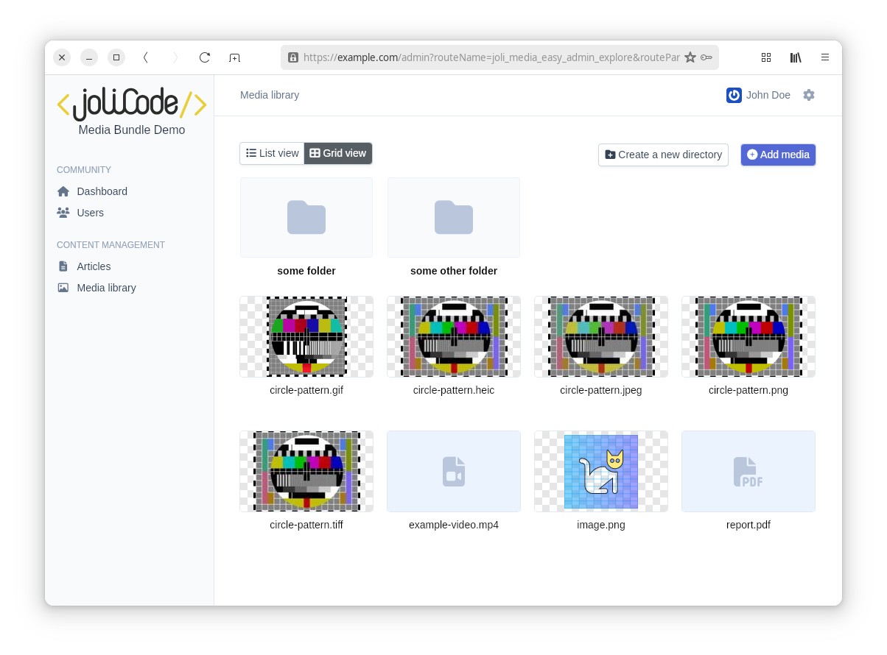

<h1 align="center">
  <a href="https://github.com/jolicode/MediaBundle"></a>
  <br />
  JoliMediaBundle
  <br />
  <sub><em><h6>Media management for Symfony: upload, store, transform, compress and display</h6></em></sub>
</h1>

JoliMediaBundle manages the media of a Symfony application, from the upload to the `` tag:
it stores the files with [Flysystem](https://flysystem.thephpleague.com/), generates optimized
variations of the images (resized, cropped, converted to WebP or AVIF), outputs responsive
markup, and adds a media library to
[EasyAdmin](https://symfony.com/bundles/EasyAdminBundle/current/index.html),
[SonataAdmin](https://symfony.com/bundles/SonataAdminBundle/current/index.html) and
[Sylius / Sylius Stack](https://stack.sylius.com/).

> [!TIP]
> Try it in your browser: [the demo application](https://mediabundle.jolicode.com/demo/) runs in
> WebAssembly, with its EasyAdmin, SonataAdmin and Sylius admins. There is nothing to install,
> and what you upload stays in your browser.

## Usage

Define a variation:

```yaml
# config/packages/joli_media.yaml
joli_media:
    libraries:
        default:
            original:
                flysystem: media.original.storage
                url_generator:
                    path: /media/original/
            cache:
                flysystem: media.cache.storage
                url_generator:
                    path: /media/cache/
            enable_auto_webp: true
            pixel_ratios: [1, 2]
            variations:
                card:
                    transformers:
                        thumbnail:
                            width: 400
                            height: 300
```

Use it in a template:

```twig
<twig:joli:Picture path="photo.jpg" variation="card" alt="A circle pattern" />
```

And get a WebP alternative, a version for high-density screens, the dimensions and lazy loading:

```html
<picture>
    <source
        sizes="400px"
        srcset="/media/cache/card-webp/photo.4ca76c43.webp 400w, /media/cache/card-2x-webp/photo.4ca76c43.webp 800w"
        type="image/webp"
        width="400"
        height="300"
    />
    
</picture>
```

Each file is generated the first time it is requested, then served as a static file.

## A media library in your admin

The [EasyAdmin](https://mediabundle.jolicode.com/bridges/easy-admin/),
[SonataAdmin](https://mediabundle.jolicode.com/bridges/sonata-admin/) and
[Sylius](https://mediabundle.jolicode.com/bridges/sylius/) bridges add a media library to browse,
upload and organize the files, and a media picker for your forms.



The bundle also comes with
[console commands](https://mediabundle.jolicode.com/misc-features/commands/) to generate and
audit the variations, a [profiler panel](https://mediabundle.jolicode.com/misc-features/debug-tooling/),
[events](https://mediabundle.jolicode.com/misc-features/events/) and a
[Doctrine type](https://mediabundle.jolicode.com/misc-features/using-in-doctrine-entities/) to
link media to your entities.

## Installation

JoliMediaBundle requires PHP 8.2 or later, and Symfony 7 or 8:

```
composer require jolicode/media-bundle
```

Then follow the [getting started guide](https://mediabundle.jolicode.com/getting-started/).

## Documentation

Read the detailed [documentation of the bundle](https://mediabundle.jolicode.com/).

Its sources are in `doc/`, and its website is built from them in `doc-website/`: run
`castor doc:start` to build it, then `castor doc:serve` to browse it on http://localhost:8000/.

## License

This software is published under the [MIT License](LICENSE.md).

<br><br>
<div align="center">
<a href="https://jolicode.com/"></a>
</div>
